<h3><code>daris@github ~ $ ./contributions.sh</code></h3>

  

<h3><code>daris@github ~ $ whoami</code></h3>
<table>
  <tr>
    <td valign="top"></td>
    <td valign="top"></td>
  </tr>
</table>
 

<h3><code>daris@github ~ $ ls ~/projets</code></h3>

| Projet | En bref | Voir |
|---|---|---|
| Réseau d'opérateur multi-sites | Relier deux entreprises réparties sur trois villes, chacune isolée dans son propre réseau privé | [Page du projet](https://darismbau.github.io/projet.html?id=mpls) |
| Infrastructure opérateur et services multimédia | Le réseau d'un opérateur et ses services (télévision par IP, téléphonie, vidéo à la demande), le tout automatisé | [Page du projet](https://darismbau.github.io/projet.html?id=operateur) |
| Réseau pour une petite structure | VLAN, adressage, services réseau et sécurité pour une entreprise | [Page du projet](https://darismbau.github.io/projet.html?id=petite-structure) |
| Vidéosurveillance intelligente avec l'IA | Détection d'objets, lecture de plaques et recherche dans les vidéos en langage naturel | [Page du projet](https://darismbau.github.io/projet.html?id=frigate) |
| Traceur GPS autonome en LoRaWAN | Un traceur qui envoie sa position et s'affiche en direct sur une carte | [Page du projet](https://darismbau.github.io/projet.html?id=lorawan) |
| Cluster de calcul distribué | Un serveur maître répartit les programmes vers le serveur le moins chargé | [Page du projet](https://darismbau.github.io/projet.html?id=cluster) · [Code](https://github.com/darismbau/Programmation_de_2eme_annee-R3.09-et-SAE3.02) |
| Analyseur de logs réseau | Outil en ligne de commande qui analyse des journaux syslog, Apache et Nginx | [Code](https://github.com/darismbau/log-analyzer) |

Travaux d'école (ENSISA) : [crossyq-reinforcement-learning](https://github.com/darismbau/crossyq-reinforcement-learning) · [digits-logreg-from-scratch](https://github.com/darismbau/digits-logreg-from-scratch) · [ensisa-ai-labs](https://github.com/darismbau/ensisa-ai-labs) · [all_td_cplusplus](https://github.com/darismbau/all_td_cplusplus)

<h3><code>daris@github ~ $ cat ~/liens</code></h3>

